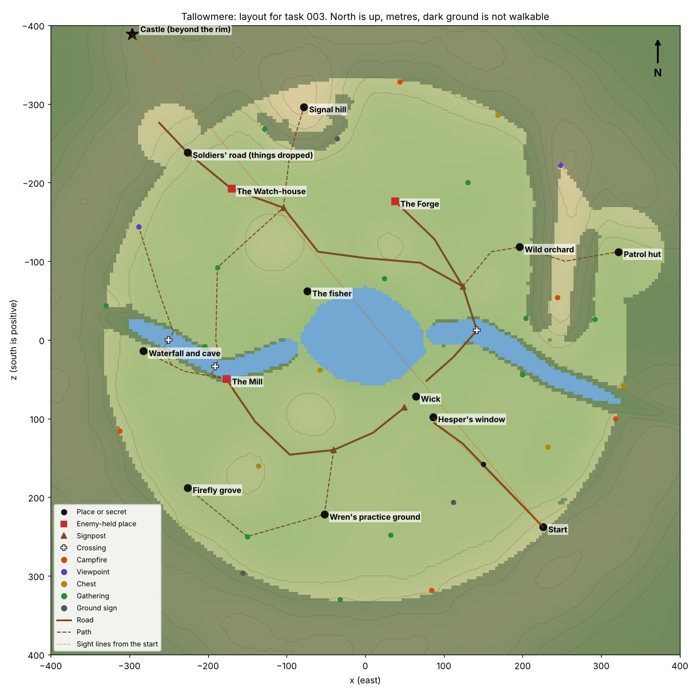

# 003 layout: where everything in Tallowmere stands

Part of task 003. Written by Claude, 12 November. It replaces the provisional placement in `src/core/world/valley.ts`, whose comment says the metres were a first guess. The data is in `docs/tasks/003-layout/layout.json`. Copy the coordinates from there; do not retype them from this page.

## Why the first placement has to change

The written lines fix more of the map than the first placement knew:

- From the patrol hut's door "the ridge fills the sky to the west" (`fragments.md`), and Hesper's patrol was "east ridge". So the ridge runs north to south on the valley's east side, the hut is beyond it, and the castle is in the west. The first placement had the ridge running east to west in the north.
- The Forge is reached by the east road, over a ford with a broken bridge beside it (`interface.md`, `households.md`, `bandits.md`). So a river crosses the east road.
- The Mill needs a river for its wheel, and has its own road (`interface.md`, "Lanterns on the mill road").
- The fisher on the lake watched the column march by torchlight, and Old Maren's second light faces the soldiers' road. So the soldiers' road runs along the lake's north shore, in sight of Wick across the water.
- The arrival view needs Hesper's window, the village, and the castle in one frame (the brief). So the start, the window, and the castle are in a line.

## Compass

`x` is east. `z` is south. North is `-z`. The sun rises in the east and sets in the west. All figures are metres.

## The places

| Id | x | z | What |
| --- | --- | --- | --- |
| `lake` | 0 | 0 | The lake's centre. The shore is about 90 m out |
| `wick` | 64 | 72 | The village's centre, on the south-east shore. It spreads about 50 m each way |
| `hesper` | 86 | 98 | Hesper's cottage, at Wick's south-east corner, the first house on the road in. Her window faces south-east, up the road |
| `start` | 226 | 238 | Where the hero begins, on a spur at the south-east pass, 198 m from Hesper's window |
| `castle` | -296 | -388 | Beyond the north-west rim, on a crag. Never walked to in this region. Its beacon tower stands about 35 m |
| `mill` | -172 | 62 | On the south bank of the river that feeds the lake. Enemy-held |
| `forge` | 38 | -176 | North of the lake, at the end of the east road. Its east fence faces the road from the ford. Enemy-held |
| `watch_house` | -170 | -192 | On the soldiers' road, below the north-west pass. Enemy-held. The supper table is inside |
| `signal_hill` | -78 | -296 | The highest ground the hero can stand on |
| `patrol_hut` | 322 | -112 | In a hollow beyond the east ridge |
| `waterfall` | -282 | 14 | The pool under the falls, south bank. The cave is behind the falls |
| `orchard` | 196 | -118 | Sedge's orchard, at the ridge's western foot |
| `practice` | -52 | 222 | Wren's practice ground, the first clearing in the south wood |
| `grove` | -226 | 188 | The firefly grove, deep in the south-west wood |
| `fisher` | -74 | -62 | The fisher's hut and boat, on the north-west shore |
| `soldiers_road` | -226 | -238 | The stretch of the soldiers' road with the helmet, the cart, and the boot |
| `family_markers` | 150 | 158 | Sixteen stones and the Fairlow stone, along the road in from (190, 200) to (110, 124) |

All ten places off the path from section 4 are here. The supper table shares the Watch-house.

## Water

- **The river in** comes over the west rim as the waterfall, runs east past the Mill, and enters the lake on its west side. Its line is `river_in` in the data.
- **The river out** leaves the lake on the east side, crosses the east road at the ford, and leaves the valley through a gorge in the south-east. Its line is `river_out`.
- **Three crossings.** The ford at (142, -12), with the broken bridge beside it (the project "The bridge to the Forge" mends it). The mill bridge at (-178, 40). Stepping stones below the falls at (-250, 0).
- The hero swims (design version 33), slowly and unarmed, so the lake and the rivers can be crossed anywhere. The three crossings are still the quick way and the only way for carts, sheep, and villagers: the ford is where the tax cart stops, and the Mill stands at the other bridge. The river also gives a quiet way in to the Mill, and the lake a quiet way to the north shore below the soldiers' road.
- The prototype's rivers are about 25 m wide because they are carved with round hollows. Make them 8 to 12 m.

## Roads and paths

In the data as `roads`. Roads are wide enough for a cart; paths are trodden ground.

| Id | Runs | Length |
| --- | --- | --- |
| `road_in` | The start, past the family markers, to Wick's south gate by Hesper's cottage | 190 m |
| `mill_road` | Wick's west gate, along the south shore, round the split oak's rise, to the Mill | 280 m |
| `east_road` | Wick's north gate, up the east shore, over the ford, to the Forge | 290 m |
| `soldiers_road` | From the east road north of the ford, west along the north shore, past the hill's foot, through the Watch-house, out by the north-west pass toward the castle | 460 m |
| `hill_path` | From the soldiers' road up to the signal hill | 130 m |
| `ridge_path` | From the ford's signpost, through the orchard, over the ridge's saddle, to the patrol hut | 220 m |
| `forest_path` | From the split oak, through the practice ground and the second clearing, to the grove. It fades out after the practice ground | 280 m |
| `falls_path` | From the Mill up the south bank to the falls | 120 m |

**Signposts** stand where roads meet: Wick's west gate (50, 86), the split oak (-40, 140), north of the ford (124, -68), and the hill's foot (-104, -168). The split oak itself is the landmark at that junction.

## Land that hides things

Each of these is a rise in the prototype. A stand of trees on top makes it certain.

| Rise | Centre | Hides |
| --- | --- | --- |
| The split oak's rise | (-70, 96) | The Mill from Wick. The mill road goes round it to the south |
| The north shore knoll | (30, -118) | The Forge from Wick and from the soldiers' road, which passes on the lake side |
| The fisher's hill | (-118, -124) | The Watch-house from Wick and the lake |
| The east ridge | (250, -250) to (246, -15) | The castle and the signal hill from the patrol hut. Cross it at the saddle, or walk round its south end |
| The forest hill | (-150, 170) | The grove from the forest path |
| The orchard bank | (150, -70) | The orchard from the east road |
| The start's spur | (236, 250) | Nothing: it lifts the start so it looks down on Wick |

## The edge

The walkable valley is roughly a circle 335 m in radius, with two bulges: the patrol hut's hollow in the east and the north-west pass. Beyond it the rim rises steeply under dense forest. The rivers enter over a cliff and leave through a gorge. The rim is lower than the signal hill, so the hill is the highest ground in sight from inside.

## The arrival view

From the start, Hesper's window bears 315 degrees (north-west), the castle 320, and the signal hill 330. One frame holds all three, with the lake between the village and the far shore. The sun sets in the west, 45 degrees to the left of the view, just outside the frame, so its last light falls across the village from the side.

Keep the line from the start to the window clear of trees and roofs: in the prototype it clears the ground by only 2 m at its lowest. Trees frame the view on both sides of that line, not on it.

## The other stops

Twenty-eight smaller things, in the data as `stops`, each with a kind and a note: five campfires, two viewpoints, five chests, twelve gathering spots, three signs on the ground, and the family markers. They are placed where the measured gaps were, and each is something the design already has (the gathering spots use only what `docs/writing/items.md` lists). Add these to `VALLEY_STOPS` as they are built.

## What was checked

`docs/tasks/003-layout/check.ts` builds a prototype of this land with the existing `createHeightAt` and tests the arrangement. Run it from the repo root: `CELL=2 npx vite-node docs/tasks/003-layout/check.ts`.

| Check | Result |
| --- | --- |
| Longest walk to something worth stopping for, 46 stops, 2 m cells | 89 m (limit 100). No stranded ground |
| The start sees Hesper's window | Clear, by 2.1 m |
| The start sees the castle's tower top | Clear, by 2.9 m |
| Wick sees the Mill, the Forge, the Watch-house | Hidden by ground: 3.9 m, 3.6 m, 7.4 m under the line |
| The patrol hut sees the castle, the signal hill | Hidden by the ridge: 28 m and 26 m under the line |
| The signal hill sees the castle and the Watch-house yard | Clear, by 1.6 m and 0.7 m |
| Wick sees the signal hill's top | Clear, by 2.3 m ("I saw the hill take light") |
| Highest ground | 64.8 m, 13 m from the hill's marked top |

**What the prototype does not prove.** Its gradients are rough: the road in, the hill path, and the ridge path are too steep in places, and the ford's banks are cliffs. The real land must grade every road to a slope the hero walks without slowing, and every path to one the hero can climb. `prototype_terrain` in the data is a starting point for `VALLEY_SHAPE`, not the answer. The sight-line margins are small, so each one becomes a test in `src/core/world` and is kept true as the land is refined.

## For Viktor

1. Replace `VALLEY_PLACES` and `VALLEY_STOPS` with this data, and reshape `VALLEY_SHAPE` to fit it. Keep the checks in the table above as tests.
2. `isWalkableGround` follows the edge described above and the two rivers, with the three crossings open. Water is swum, not walked: keep it out of `isWalkableGround`, and measure the 100 m rule on ground only.
3. If something here cannot be built as placed, say so in `docs/status.md` with the measurement, and move on to the next thing. Do not move a place yourself.

One correction to review 017: it called the patrol hut an enemy place. It is not; it is an empty hut and one of the ten places off the path. The rule for it is the secret's rule, hidden from the nearest path, which the ridge does.
