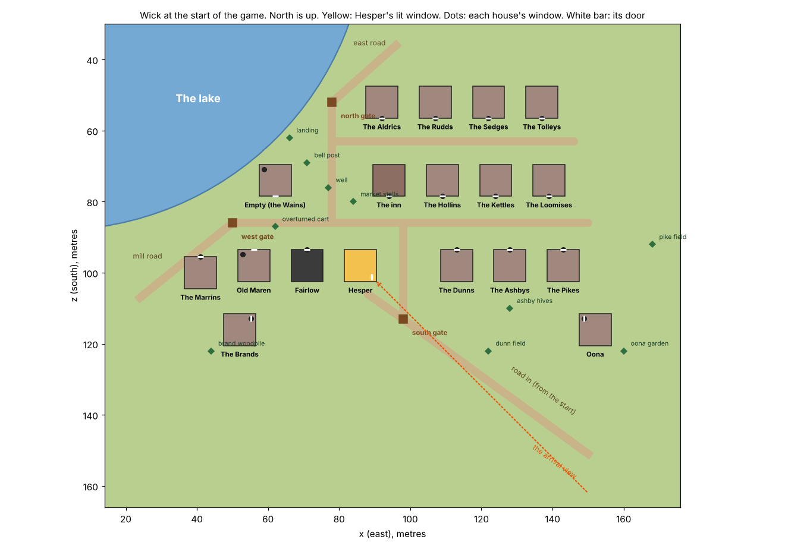

# 003 Wick: the village plan

Part of task 003 step 2. Written by Claude, 12 November. It says where every building in Wick stands at the start of the game. The data is in `docs/tasks/003-layout/wick.json`; copy from there. It fits inside `docs/tasks/003-layout.md` and changes nothing in it.

## What the plan has to do

- **Seventeen windows and an inn.** One house for each of the sixteen households, the Fairlow house, and the inn, which is not one of the windows.
- **The arrival view.** Hesper's cottage is the first house on the road in, with its window facing south-east up the road. Nothing stands between it and the start. The dark Fairlow house is next door, so the one lit window and the house it is waiting for are seen together.
- **What the written lines fix:**
  - Old Maren "lives two doors from Hesper" (`households.md`): Hesper, the Fairlow house, Maren. Her window looks north-west across the lake to the soldiers' road (`stories.md`).
  - The Wains want "a window that faces the lake": the empty house on the shore is the one they take.
  - Oona "lives alone at the edge of the village with a garden gone wild."
  - The Brands are "from the forest edge": their house is the one nearest the south wood.
  - Villagers "gather at the well at dusk", so the well is in the square, where the lanes meet.

## The lanes

| Lane | Runs |
| --- | --- |
| High lane | From the west gate east through the square to the last house |
| Gate lane | From the south gate north to the high lane, passing Hesper's east wall |
| Shore lane | From the square north along the water to the north gate |
| Back lane | East from the shore lane, between the two northern rows |

Three gates, each where a road from `003-layout.md` arrives: the south gate (98, 113) on the road in, the west gate (50, 86) on the mill road, the north gate (78, 52) on the east road. A gate is two posts and a broken bar, with a low fence or a hedge running a little way either side. Wick has no wall.

## The houses

Sixteen homes, the Fairlow house, and the inn. Coordinates, door and window bearings, and which model each uses are in the data. The rows:

- **South row**, facing north onto the high lane: the Marrins (outside the west gate, first on the mill road), Old Maren, the Fairlow house, Hesper, then east of the gate lane the Dunns, the Ashbys, and the Pikes.
- **Middle row**, facing south onto the high lane: the empty shore house, the square, the inn, the Hollins beside it, the Kettles, the Loomises.
- **North row**, facing south onto the back lane: the Aldrics by the north gate (the east road leads to the Forge), the Rudds, the Sedges, the Tolleys.
- **Apart:** Oona to the south-east with her garden. The Brands to the south-west, toward the wood.

At the start: Hesper's is open and lit. Old Maren's is lived in but dark, and is not boarded. The inn is roofless (`building_destroyed`). Every other house is boarded, with planks across the door and windows of the ordinary model (review 012).

## The square and the small things

In the data as `things`: the well with a dead tree across it, the bell post with the bell lying beside it, three bare stall frames, the overturned cart on the high lane, the landing with one sunk boat, the Ashbys' empty hives, Oona's garden, the Brands' woodpile, and the Pikes' and Dunns' empty fields. The well, the bell, the stalls, and the inn are four of the projects in `interface.md` and must look unfinished in a way the finished thing will visibly mend.

## Rules for building it

1. **It is not a grid.** The plan is drawn square so it can be read. Turn each house up to 12 degrees and shift it up to 2 m, from the seed, so no two walls line up. Keep every door on its lane.
2. **Vary the houses.** `home_A` and `home_B` alternate in the data; use the four roof colours so neighbours differ.
3. **Abandoned at a glance.** Weeds in every lane and yard, grass through the square's cobbles, leaning fences with gaps, shutters hanging, no smoke but Hesper's, no animals.
4. **Wick stands on a shelf.** The ground under the village is nearly level, 2 to 4 m above the lake, with no slope over 0.1 under a house. As the land is now, the plots range from 6.7 to 13.7 m and the shore is 25 to 35 m short of the village.
5. **The water comes to the village.** The lake's edge on this side is at the landing (66, 62) and within 10 m of the bell post. Design version 34 already says the land comes down to the water.
6. **Keep the arrival line clear.** Nothing taller than a fence within 8 m of the line from the start to Hesper's window, south of her house. The Dunns' field lies beside that line: keep its weeds low.
7. **Hesper's lamp is the only light** in the village at 18:00, and the brightest thing in every dusk and night frame.

## What was checked

Against `valleyHeightAt` on `main` at `b08f7c3`: all eighteen plots and all ten things are on dry land. The closest two houses are 15 m apart, centre to centre. The 9 m footprint is an estimate from the style test's spacing; measure the models at scale 8 and say in `docs/status.md` if a plot is too small.

## Evidence wanted, with step 2

A frame of Wick from above at noon with every house in it, and the brief's frames: the arrival view at 18:00 in both camera views, Wick at noon and at night from the square, and the hero and the brute at a house door.

## Built (12 November, by Claude)

The village is built as a module, so step 2 wires it in and does not rebuild it. See it at `?styletest=wick`; frames are in `docs/pr-media/wick/`.

| File | What it is |
| --- | --- |
| `src/village/plan.ts` | Pure. Every house's place, turn, model, roof colour, and state, from the seed (rules 1 and 2) |
| `src/village/shelf.ts` | Pure. `withWickShelf(heightAt, water)`: the level shelf and the bay at the landing (rules 4 and 5) |
| `src/village/build.ts` | `buildWick(scene, { heightAt, seed, shadow })`: houses, planks on the boarded ones, Hesper's lit window, lamp and smoke, lanes, gates and fences, the ten things, weeds |
| `src/village/village.test.ts` | Holds the rules: 17 windows and an inn, the shelf's heights and slopes, the bay joined to the lake |

To wire it in:

1. In `valleyHeightAt`, wrap the land with `withWickShelf(..., WATER_LEVEL)`, so walking, the terrain mesh, and the tests all see the same ground. Then run the walk gap and the sight-line checks again.
2. In the valley scene: `const wick = await buildWick(scene, { heightAt: valleyHeightAt, seed: VALLEY_SEED, shadow })`, and call `wick.light(lighting, tod)` whenever the light changes.
3. Add a `GlowLayer` if the scene has none: the window is the only emissive thing in the village.

Measured with the shelf on today's land: the start still sees Hesper's window, clear by 1.9 m (unchanged). Wick is better hidden from the Mill, the Forge, and the Watch-house than before. "Wick sees the signal hill's top" is clear by only 0.1 m; if the land work moves it under, raise the hill or say so.

Not built: the people, the inn's interior, collision with houses and fences, and trees. The door and window positions for the two house models are in `OPENINGS` in `build.ts`, measured from the models at scale 8.
